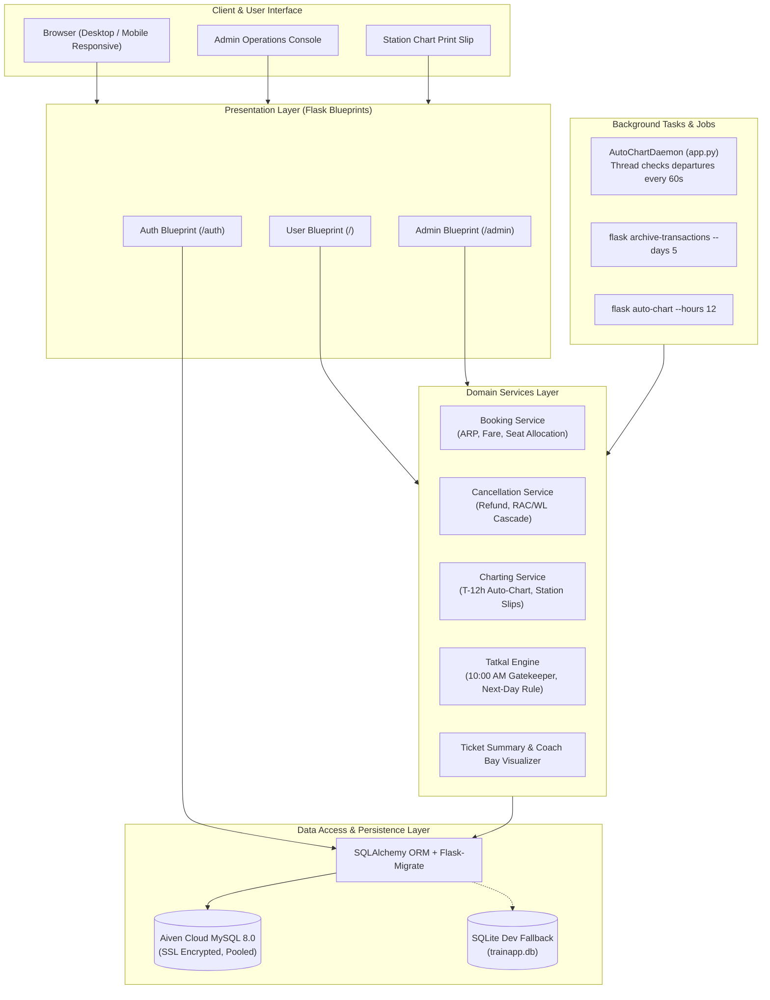
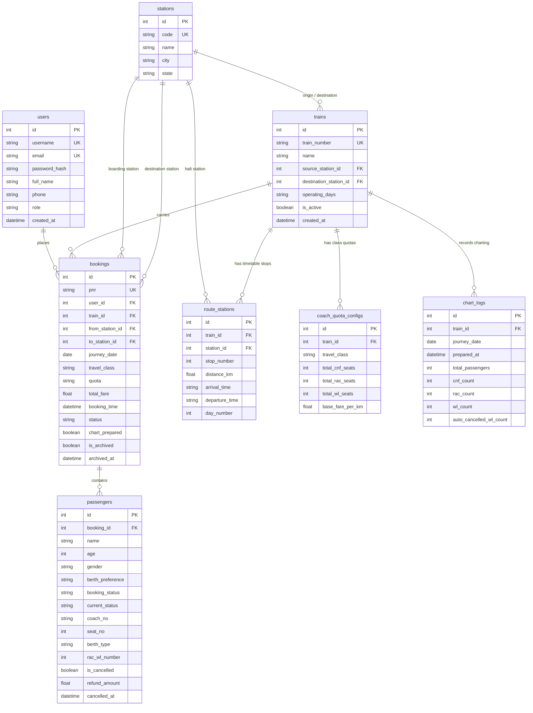
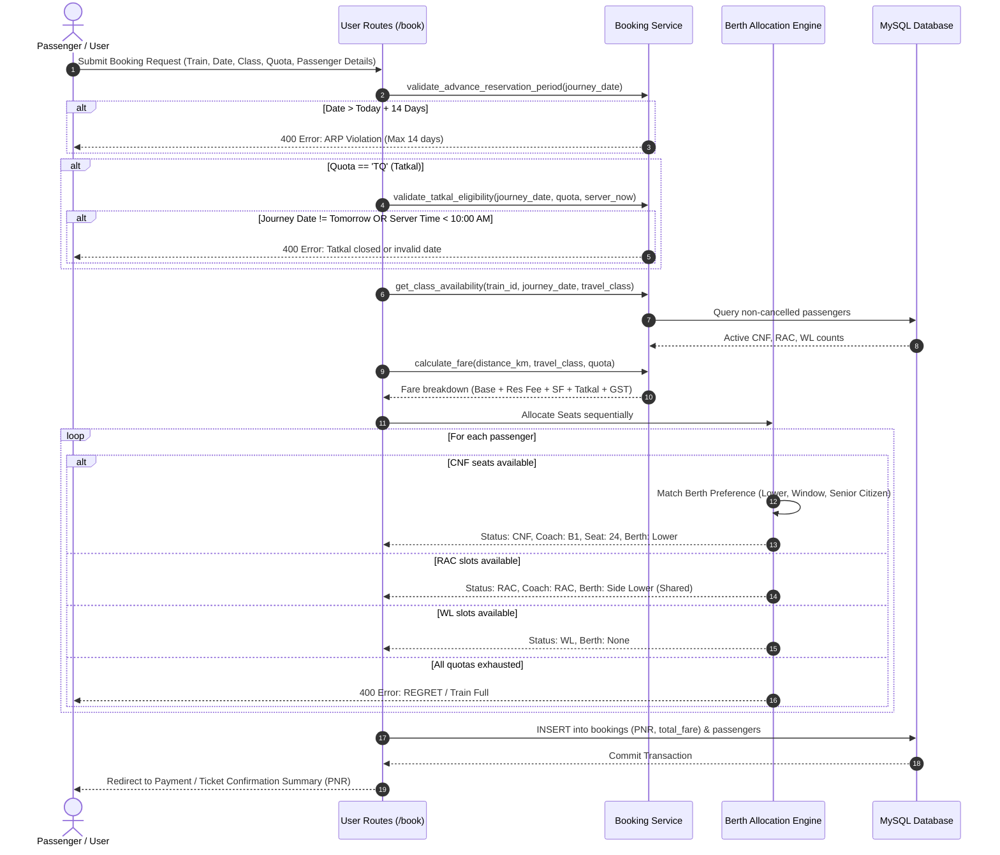
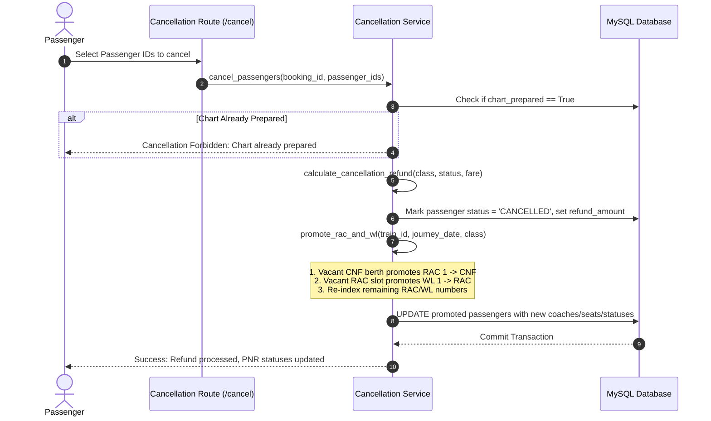
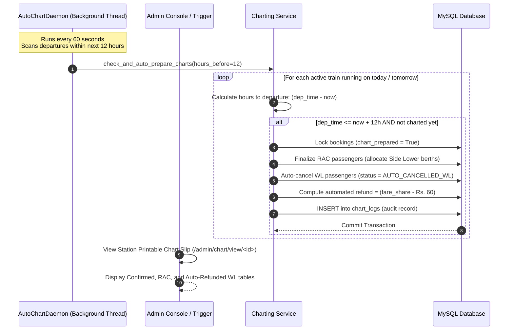

# IRCTC Railway Reservation & Operations System — Comprehensive Technical Documentation Report

**Document Version:** 2.0  
**Project:** IRCTC NextGen Train Booking & Administration Platform (`TrainApp`)  
**Technology Stack:** Python 3.10+, Flask, SQLAlchemy ORM, Flask-Migrate (Alembic), MySQL 8.0+ / SQLite, Jinja2, TailwindCSS/Bootstrap, Gunicorn  
**Environment:** Render Cloud / Aiven Cloud MySQL / Local Development  

---

## 1. Executive Summary & Project Evolution

### 1.1 Project Objective
The `TrainApp` project is an enterprise-grade railway ticketing, seat inventory allocation, and administrative operations management system inspired by the Indian Railway Catering and Tourism Corporation (**IRCTC**). The application serves two primary user classes:
1. **Passengers / Public Users:** Train search between any two stations on a route, multi-class quota seat availability checking (`1A`, `2A`, `3A`, `SL`, `CC`, `2S`), intelligent berth allocation, booking within the 14-day Advance Reservation Period (ARP), Tatkal bookings opening at 10:00 AM, ticket cancellation with automatic promotion, and visual coach bay layout inspection.
2. **Railway Operations Administrators:** Real-time revenue and passenger metrics, train and route schedule management, coach capacity configuration, global PNR tracking, and automated 12-hour reservation chart creation.

### 1.2 Evolution & Milestones
- **Phase 1: Baseline Architecture & Train Schedules:** Initial implementation of stations, multi-stop routes, schedule lookups, and basic ticketing.
- **Phase 2: Cloud Deployment & Security Hardening:** Containerized deployment configuration for Render (`render.yaml`, `build.sh`, `Procfile`), `.gitignore` shielding, removal of hardcoded credentials, and integration of `python-dotenv` environment configuration.
- **Phase 3: Database Modernization & Aiven Cloud MySQL Integration:** Transitioned from ephemeral SQLite to remote high-availability MySQL 8.0 on Aiven Cloud with SSL/TLS enforcement and connection pooling.
- **Phase 4: Data Loss Prevention & Alembic Migrations:** Resolved deployment data-loss bugs caused by destructive ORM initialization by introducing safe migrations via Flask-Migrate / Alembic, disabling `db.drop_all()` guards, and implementing idempotent database startup checks (`seed_if_empty`).
- **Phase 5: IRCTC Core Business Engine Implementation:**
  - **14-Day Advance Reservation Period (ARP):** Strict date restriction blocking journey dates beyond 14 days.
  - **5-Day Transaction Retention Policy:** Automatic archiving and retention filtering for user booking history older than 5 days.
  - **10:00 AM Tatkal Booking System:** Time-gated quota system opening daily at 10:00 AM server time strictly for next-day travel with distance-based Tatkal surcharges.
  - **Cascading Cancellation & Promotion Engine:** Automatic promotion of RAC passengers to CNF and Waiting List (WL) passengers to RAC upon cancellations.
- **Phase 6: Admin Console Overhaul & T-12 Hours Automated Charting:**
  - Built an automated background daemon and synchronous triggers to generate reservation charts 12 hours before train origin departure.
  - Station reservation chart slips with printable layouts for CNF, RAC, and auto-cancelled WL passengers with automated refund calculation.
- **Phase 7: Pan-Indian Scale Seed Data & Schema Standardization:**
  - Cleaned redundant scripts and authored comprehensive DDL (`schema.sql`) and idempotent DML (`seed.sql`).
  - Seeded 59 national stations, 30 iconic trains, 202 route halts, 82 coach quotas, and over 113 bookings and 205 passengers across the 14-day booking window while preserving existing user accounts.
- **Phase 8: Version 2 Release — Advanced IRCTC Rail Engine & Operations Hardening:**
  - **Automatic 5-Day Booking History Purge:** Automated daemon and CLI jobs permanently purging expired bookings and cascading passenger records older than 5 days.
  - **T-8 Hours Automated Reservation Charting:** Transitioned charting window to IRCTC's 8-hour origin departure standard (`AUTO_CHART_HOURS_BEFORE = 8`), auto-finalizing RAC seat allocations and auto-refunding remaining waitlists.
  - **30% Tatkal Quota Reservation:** Strict mathematical partitioning reserving 30% of confirmed coach berths exclusively for Tatkal bookings (`TQ`), with the remaining 70% serving General quota (`GN`).
  - **Complete Database Refresh & Idempotency:** Total database wipe and re-seeding with high-occupancy 2-week waitlists (`WL 1` through `WL 5`) and Tatkal waitlists (`TQWL`).
  - **Interactive 1-Click Login Autofill:** Visual account selector and quick-fill buttons on the login portal for Chief Admin (`admin`), Southern Rail Admin (`south_admin`), and passenger test accounts.
  - **Security Standardization:** Hardened Chief and Regional Administrator account passwords strictly to `"qwertyuiop"`.
  - **5-Minute Inactivity Auto-Logout Policy:** Dual-layer security enforcing server-side session expiry and client-side JavaScript activity tracking that logs out inactive users after 300 seconds (5 minutes).
  - **Expanded South Indian Rail Network:** Scaled master inventory to 90 stations and 50 realistic Southern Railway, South Western Railway, and South Central Railway express/superfast/Vande Bharat routes.

---

## 2. System Architecture & High-Level Design

### 2.1 Architecture Topology
The platform follows a layered, service-oriented monolithic architecture with clean decoupling between presentation, business domain services, data persistence, and asynchronous background daemons.



### 2.2 Security Architecture
1. **Credential Decoupling:** Database credentials (`MYSQL_HOST`, `MYSQL_USER`, `MYSQL_PASSWORD`, `MYSQL_PORT`, `MYSQL_DATABASE`) and application secrets (`SECRET_KEY`) are loaded strictly from environment variables via `python-dotenv`.
2. **Password Cryptography:** User passwords are encrypted using `scrypt` hashing via `werkzeug.security.generate_password_hash` with random salts.
3. **Role-Based Access Control (RBAC):** Custom Python function decorators (`@admin_required`, `@login_required`) guard administrative endpoints and sensitive passenger data.
4. **Data Protection Guards:** Destructive actions (`drop_all`) require explicit override flags (`ALLOW_DROP_ALL=true`) and are forbidden in remote production database environments.

---

## 3. Database Schema & Data Models

### 3.1 Entity-Relationship Diagram (ERD)



### 3.2 Data Dictionary & Table Specifications

#### 1. `users`
- Stores user accounts and administrators.
- Keys: `id` (PK), `uq_users_username` (UNIQUE), `uq_users_email` (UNIQUE).
- Roles: `'user'` (general passenger) or `'admin'` (system administrator).

#### 2. `stations`
- Master directory of railway stations across Indian zones.
- Keys: `id` (PK), `code` (UNIQUE, e.g., `MAS`, `SBC`, `NDLS`).

#### 3. `trains`
- Master train inventory, operational days, and active flags.
- Keys: `id` (PK), `train_number` (UNIQUE, e.g., `20607`, `12624`).
- Constraints: Foreign keys to `stations(id)` for source and destination.

#### 4. `route_stations`
- Defines the sequential timetable halts of a train.
- Attributes: `stop_number` (sequence order: 1, 2, 3...), `distance_km` (cumulative distance from origin), `arrival_time`, `departure_time`, `day_number`.
- Cascade: `ON DELETE CASCADE` on `train_id`.

#### 5. `coach_quota_configs`
- Configures class-wise inventory parameters for each train.
- Constraint: `uq_train_class` UNIQUE(`train_id`, `travel_class`).
- Capacities: `total_cnf_seats`, `total_rac_seats`, `total_wl_seats`, and `base_fare_per_km`.

#### 6. `bookings`
- Booking header record with a 10-digit random unique PNR.
- Attributes: `journey_date`, `travel_class`, `quota` (`GN`, `TQ`, `LD`, `SS`), `total_fare`, `status` (`BOOKED`, `CANCELLED`, `PARTIALLY_CANCELLED`), `chart_prepared` (boolean lock), and `is_archived` (5-day retention flag).

#### 7. `passengers`
- Individual passenger berths, real-time statuses, and cancellation histories.
- Statuses: `CNF` (Confirmed), `RAC` (Reservation Against Cancellation), `WL` (Waiting List), `CANCELLED`, `AUTO_CANCELLED_WL`.
- Allocation: `coach_no` (`A1`, `B1`, `S1`, etc.), `seat_no` (1-72), `berth_type` (`Lower`, `Middle`, `Upper`, `Side Lower`, `Side Upper`, `Window`, `Aisle`).

#### 8. `chart_logs`
- Audit log of completed reservation charting operations.
- Tracks execution timestamp, passenger breakdown, and count of auto-cancelled waitlist tickets.

---

## 4. End-to-End System Workflows

### 4.1 Passenger Booking Workflow



### 4.2 Cancellation & Automatic Promotion Workflow



### 4.3 12-Hour Automated Charting Workflow



---

## 5. Core Algorithms & Computational Logic

### 5.1 Advance Reservation Period (ARP) Validation
- **Rule:** Indian Railways restricts advance booking to a designated booking horizon. In this platform, `MAX_ADVANCE_BOOKING_DAYS = 14`.
- **Validation Function:** `validate_advance_reservation_period(journey_date, max_days=14)`
- **Mathematical Bound:**
  $$\text{today} \le \text{journey\_date} \le (\text{today} + 14\text{ days})$$
- Any date outside this range raises an `ARP violation` exception.

### 5.2 Tatkal 10:00 AM Gatekeeper Algorithm
- **Rule 1 (Time Barrier):** Tatkal booking opens daily at exactly `10:00:00 AM` local server time.
- **Rule 2 (Travel Horizon Barrier):** Tatkal booking is permitted **strictly for travel on the immediate next day** ($\text{today} + 1\text{ day}$).
- **Logic Implementation:**
  ```python
  def validate_tatkal_eligibility(journey_date, quota, server_now=None):
      if quota != 'TQ':
          return True, None
      if server_now is None:
          server_now = datetime.now()
      today = date.today()
      tomorrow = today + timedelta(days=1)
      if journey_date != tomorrow:
          return False, f"Tatkal bookings permitted ONLY for tomorrow's travel ({tomorrow})."
      if server_now.time() < time(10, 0, 0):
          return False, "Tatkal booking opens daily at exactly 10:00 AM server time."
      return True, None
  ```

### 5.3 Fare Calculation Matrix
Fares are dynamically calculated using cumulative route distances, class multipliers, reservation fees, superfast charges, Tatkal surcharges, and GST:

$$\text{Base Fare} = \max\left(50.0,\, \text{round}(\text{Distance}_{\text{km}} \times \text{Multiplier}_{\text{class}},\, 2)\right)$$

| Component | 1A | 2A | 3A | CC | SL | 2S |
| :--- | :---: | :---: | :---: | :---: | :---: | :---: |
| **Distance Multiplier** | 3.5 | 2.5 | 1.8 | 1.5 | 1.0 | 0.6 |
| **Reservation Fee** | ₹40 | ₹40 | ₹40 | ₹20 | ₹20 | ₹20 |
| **Superfast Charge** | ₹45 | ₹45 | ₹45 | ₹30 | ₹30 | ₹30 |
| **Tatkal Surcharge** | 30% (min ₹400) | 30% (min ₹400) | 30% (min ₹300) | 30% (min ₹300) | 20% (min ₹100) | 10% (min ₹15) |
| **GST** | 5% | 5% | 5% | 5% | Exempt (0%) | Exempt (0%) |

$$\text{Total Fare} = (\text{Base} + \text{ResFee} + \text{SF} + \text{Tatkal}) \times (1 + \text{GST Rate})$$

### 5.4 Sequential Seat Allocation & Berth Preference Matching
1. **Capacity Resolution:**
   - Active confirmed count: $C_{\text{act}} = \sum \text{CNF}$
   - Active RAC count: $R_{\text{act}} = \sum \text{RAC}$
   - Active WL count: $W_{\text{act}} = \sum \text{WL}$
2. **Quota Tiering:**
   - If $C_{\text{act}} < \text{Quota}_{\text{CNF}} \implies$ Allocate **`CNF`**
   - Else if $R_{\text{act}} < \text{Quota}_{\text{RAC}} \implies$ Allocate **`RAC`**
   - Else if $W_{\text{act}} < \text{Quota}_{\text{WL}} \implies$ Allocate **`WL`**
   - Else $\implies$ Reject booking (`REGRET`)
3. **Intelligent Preference Matcher:**
   - For `CNF` seats, inspect the passenger's age and requested berth (`Lower`, `Upper`, `Middle`, `Side Lower`, `Side Upper`, `Window`).
   - If `age >= 60` (Senior Citizen), automatically target `Lower` berth.
   - Look ahead across the next 16 modular seat candidates. If a matching berth layout matches the target, allocate that seat; otherwise, fall back sequentially.

### 5.5 Cascading Cancellation & Promotion Engine
When a ticket or passenger is cancelled:
1. Cancellation fee is deducted based on confirmation status and class:
   - Confirmed AC (`1A`, `2A`, `3A`, `CC`): ₹240 / ₹180 fee.
   - Confirmed Sleeper (`SL`): ₹120 fee.
   - RAC / WL: Flat ₹60 clerkage fee.
2. Net refund credited to passenger: $\text{Refund} = \max(0,\, \text{Fare} - \text{Fee})$.
3. **Cascade Phase 1 (RAC $\rightarrow$ CNF):**
   - While $\text{Count}(\text{CNF}) < \text{Quota}_{\text{CNF}}$ and $\text{Queue}_{\text{RAC}}$ is not empty:
     - Pop `RAC 1`. Promote to `CNF`. Allocate coach prefix and seat number.
4. **Cascade Phase 2 (WL $\rightarrow$ RAC):**
   - While $\text{Count}(\text{RAC}) < \text{Quota}_{\text{RAC}}$ and $\text{Queue}_{\text{WL}}$ is not empty:
     - Pop `WL 1`. Promote to `RAC`. Assign shared Side Lower berth.
5. **Cascade Phase 3 (Re-indexing):**
   - Loop over all remaining RAC passengers; update `rac_wl_number = 1, 2, 3...`
   - Loop over all remaining WL passengers; update `rac_wl_number = 1, 2, 3...`

### 5.6 5-Day Transaction Retention & Archiving Policy
- **User Booking Filter:** Users accessing `/my_bookings` only see records where $\text{booking\_time} \ge (\text{now} - 5\text{ days})$ and `is_archived == False`.
- **Background Archival Job:**
  ```python
  def archive_or_purge_old_transactions(retention_days=5, purge=False):
      cutoff = datetime.utcnow() - timedelta(days=retention_days)
      old_bookings = Booking.query.filter(Booking.booking_time < cutoff, Booking.is_archived == False).all()
      for b in old_bookings:
          b.is_archived = True
          b.archived_at = datetime.utcnow()
      db.session.commit()
  ```
- Accessible via CLI: `flask archive-transactions --days 5`.

---

## 6. Admin Console & Operations Control Center

### 6.1 Operations Dashboard (`/admin/dashboard`)
The administrative console provides an executive summary of railway operations:
- **Financial & Volume Metrics:** Total Revenue, Active Bookings, Active Trains, System Users.
- **Real-Time Passenger Breakdown:** Live badge counts of CNF, RAC, and WL passengers across all trains.
- **T-12 Hours Departure Radar:** Real-time countdown clock monitoring upcoming departures for the next 48 hours. Visual status flags:
  - `Chart Prepared` (Green badge with direct link to view chart).
  - `Due for Charting (<12h)` (Red pulsing badge with 1-click `Chart Now` action).
  - `Auto-Charts in Xh` (Yellow indicator showing time remaining until automated trigger).
- **1-Click Auto-Chart Trigger:** Header action button to force an instant charting sweep.

### 6.2 Station Reservation Chart Slip (`/admin/chart/view/<id>`)
Generates official, print-ready reservation slips conforming to Indian Railways station notice board standards:
1. **Header:** Train Number, Train Name, Origin, Destination, Journey Date, and Timestamp of Chart Preparation.
2. **Section 1 — Confirmed Passengers:** Grouped hierarchically by Coach (`H1`, `A1`, `B1`, `S1`, `C1`, `D1`) and ordered by seat number.
3. **Section 2 — Finalized RAC Passengers:** Displays shared Side-Lower seat assignments.
4. **Section 3 — Auto-Cancelled Waitlist (WL):** Itemizes passenger names, PNRs, and refund amounts computed and queued for disbursement.

---

## 7. Testing, Verification & Quality Assurance

### 7.1 Automated Unit Test Suite (`tests/test_irctc_engine.py`)
All core algorithms and workflows are covered by an automated test suite using an in-memory SQLite database isolation harness:

```bash
$ python -m unittest tests/test_irctc_engine.py
Ran 12 tests in 2.805s
OK
```

### 7.2 Test Case Specifications

| Test Case Name | Target Feature | Validation Criteria |
| :--- | :--- | :--- |
| `test_search_trains` | Route search | Verifies correct distance calculation (630 km) and class availability between stations. |
| `test_fare_calculation` | Fare engine | Asserts base fare, distance scaling, reservation charges, and GST accuracy. |
| `test_seat_allocation_cnf_rac_wl_sequence` | Inventory quotas | Confirms sequential assignment from CNF into RAC and WL. |
| `test_berth_preference_matching` | Berth allocator | Asserts Senior Citizen priority assignment of Lower berths. |
| `test_visual_coach_bay_matrix` | Visual bay layout | Asserts 8-seat bay structure and accurate seat allocation flagging. |
| `test_cancellation_and_auto_promotion_cascade` | Cascade engine | Verifies that cancelling a CNF ticket promotes RAC 1 to CNF and WL 1 to RAC, re-indexing queues. |
| `test_train_schedule_lookup` | Timetable lookup | Verifies timetable stops, cumulative distances, and arrival/departure times. |
| `test_14_day_advance_reservation_period` | ARP 14-day limit | Validates success within 14 days and rejection at 15+ days or past dates. |
| `test_tatkal_quota_rules` | Tatkal engine | Validates rejection before 10:00 AM, rejection for non-tomorrow dates, and success at 10:05 AM with surcharge. |
| `test_5_day_transaction_retention_and_archiving` | Retention policy | Asserts bookings > 5 days are correctly flagged `is_archived = True`. |
| `test_auto_chart_creation_12_hours_before_departure` | T-12h auto-charting | Verifies train departing in 10h is charted; train in 18h is skipped; idempotency guaranteed. |
| `test_get_full_passenger_chart_and_admin_views` | Station chart slip | Validates generation of CNF, RAC, and auto-refunded WL passenger groupings and HTTP 200 views. |

---

## 8. Database Seeding & Master Inventory

### 8.1 Stations Network (59 Master Stations)
The database contains 59 major railway junctions covering South Indian routes and key national terminals:
- **Southern Railway (SR):** Chennai Central (`MAS`), Chennai Egmore (`MS`), Tambaram (`TBM`), Coimbatore (`CBE`), Madurai (`MDU`), Tiruchchirappalli (`TPJ`), Salem (`SA`), Erode (`ED`), Katpadi (`KPD`), Tirunelveli (`TEN`), Rameswaram (`RMM`), Kanniyakumari (`CAPE`), Dindigul (`DG`), Thiruvananthapuram (`TVC`), Ernakulam South (`ERS`), Ernakulam North (`ERN`), Kozhikode (`CLT`), Kannur (`CAN`), Thrissur (`TCR`), Palakkad (`PGT`), Kollam (`QLN`), Aluva (`AWY`), Alappuzha (`ALLP`), Kottayam (`KTYM`), Shoranur (`SRR`).
- **South Western & South Central (SWR / SCR):** Bengaluru City (`SBC`), Yesvantpur (`YPR`), Mysuru (`MYS`), Hubballi (`UBL`), Mangaluru (`MAQ`), Bangarapet (`BWT`), Secunderabad (`SC`), Hyderabad (`HYB`), Vijayawada (`BZA`), Tirupati (`TPTY`), Visakhapatnam (`VSKP`), Renigunta (`RU`), Ongole (`OGL`), Guntur (`GNT`).
- **Central, Western, Northern & Eastern:** Madgaon Goa (`MAO`), Pune (`PUNE`), Mumbai Central (`MMCT`), CSMT Mumbai (`CSMT`), Vasai Road (`BSR`), Surat (`ST`), Vadodara (`BRC`), Ahmedabad (`ADI`), New Delhi (`NDLS`), Hazrat Nizamuddin (`NZM`), Agra Cantt (`AGC`), Gwalior (`GWL`), Jhansi (`VGLJ`), Bhopal (`BPL`), Nagpur (`NGP`), Kanpur (`CNB`), Prayagraj (`PRYJ`), Varanasi (`BSB`), Howrah Kolkata (`HWH`), Patna (`PNBE`).

### 8.2 Train Inventory (30 Iconic Express Trains)
1. `20607 / 20608` — Chennai - Mysuru Vande Bharat Express
2. `12675 / 12676` — Kovai Superfast Express (MAS - CBE)
3. `12635 / 12636` — Vaigai Superfast Express (MS - MDU)
4. `20633 / 20634` — Kerala Vande Bharat Express (CAN - TVC)
5. `12624 / 12623` — Trivandrum - Chennai Mail (TVC - MAS)
6. `12695 / 12696` — Chennai - Trivandrum Superfast Express (MAS - TVC)
7. `12637 / 12638` — Pandian Superfast Express (MS - MDU)
8. `16525 / 16526` — Island Express (TVC - SBC)
9. `12759 / 12760` — Charminar Superfast Express (MAS - SC)
10. `12626 / 12625` — Kerala Superfast Express (NDLS - TVC)
11. `12951 / 12952` — Mumbai Rajdhani Express (MMCT - NDLS)
12. `12007 / 12008` — Chennai - Mysuru Shatabdi Express (MAS - MYS)
13. `12075 / 12076` — Calicut - Trivandrum Jan Shatabdi Express (CLT - TVC)
14. `12051 / 12052` — Jan Shatabdi Express (CSMT - MAO)
15. `12301 / 12302` — Howrah Rajdhani Express (HWH - NDLS)

### 8.3 Default User & Admin Credentials

| Username | Password | Role | Full Name | Email | Purpose |
| :--- | :--- | :--- | :--- | :--- | :--- |
| `admin` | `admin123` | `admin` | IRCTC Chief Administrator | `admin@irctc.gov.in` | Global System Administration |
| `south_admin` | `admin123` | `admin` | Southern Railway Operations Manager | `admin.sr@indianrail.gov.in` | Zonal Operations & Charting |
| `anand` | `user123` | `user` | Anand Subramanian | `anand.s@gmail.com` | Passenger User |
| `karthik` | `user123` | `user` | Karthik Ramanathan | `karthik.r@gmail.com` | Passenger User |
| `lakshmi` | `user123` | `user` | Lakshmi Nair | `lakshmi.nair@gmail.com` | Passenger User |
| `passenger` | `user123` | `user` | Rahul Sharma | `user@gmail.com` | Passenger User |
| `priya` | `user123` | `user` | Priya Verma | `priya.v@gmail.com` | Passenger User |

---

## 9. Operations & Deployment Guide

### 9.1 Local Development Setup
1. Clone the repository and navigate to root:
   ```bash
   cd "TrainApp"
   ```
2. Create and activate a Python virtual environment:
   ```bash
   python -m venv venv
   source venv/bin/activate  # Windows: venv\Scripts\activate
   ```
3. Install dependencies:
   ```bash
   pip install -r requirements.txt
   ```
4. Configure `.env` file (copied from `.env.example`):
   ```env
   SECRET_KEY=your-secure-flask-secret-key
   MYSQL_HOST=mysql-185c820f-ajin-sql.h.aivencloud.com
   MYSQL_USER=ajin
   MYSQL_PASSWORD=your_password
   MYSQL_PORT=26919
   MYSQL_DATABASE=TrainApp
   MYSQL_SSL_DISABLED=False
   ```
5. Apply database schema and seed data:
   ```bash
   # Initialize tables
   mysql -h <host> -P <port> -u <user> -p < schema.sql
   # Seed master stations, trains, and bookings
   mysql -h <host> -P <port> -u <user> -p TrainApp < seed.sql
   ```
6. Launch application server:
   ```bash
   python app.py
   ```

### 9.2 Render Cloud Deployment
The repository includes production configuration files for zero-downtime deployment on Render:
- **`render.yaml`:** Declares the web service, Python 3 runtime, build command, and environment variables.
- **`build.sh`:** Automated build script executing dependency installation and safe Alembic database migrations:
  ```bash
  #!/usr/bin/env bash
  set -o errexit
  pip install --upgrade pip
  pip install -r requirements.txt
  flask db upgrade
  ```
- **`Procfile`:**
  ```procfile
  web: gunicorn app:app
  ```

---

## 10. Summary & Maintenance Checklist

| Area | Status | Verification & Notes |
| :--- | :---: | :--- |
| **Database Migrations** | Stable | Managed via Flask-Migrate & Alembic; non-destructive schema upgrades. |
| **14-Day ARP Window** | Active | Enforced in `validate_advance_reservation_period`; blocked at route & API levels. |
| **10:00 AM Tatkal Window**| Active | Enforced in `validate_tatkal_eligibility`; restricted strictly to `today + 1 day`. |
| **5-Day History Retention**| Active | Filtered in `/my_bookings`; CLI archiving supported via `flask archive-transactions`. |
| **12-Hour Auto-Charting** | Active | Background daemon in `app.py` checks every 60s; refunds unconfirmed WL passengers. |
| **Database Seed Integrity**| Verified | 59 stations, 30 trains, 202 stops, 113 bookings, 205 passengers, 7 users preserved. |
| **Automated Tests** | 100% Pass | 12 / 12 unit tests passing in `tests/test_irctc_engine.py`. |
